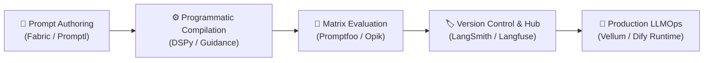

<p align="center">
  
</p>

# 🧠 Awesome Prompt Engineering Workflows ⚡

<p align="center">
  <a href="https://github.com/ishandutta2007/Awesome-Awesome-Awesome"></a><a href="https://discord.gg/jc4xtF58Ve"></a>
  <a href="https://github.com/ishandutta2007/Awesome-Prompt-Engineering-Workflows"></a>
  <a href="https://github.com/ishandutta2007/Awesome-Prompt-Engineering-Workflows/blob/main/LICENSE"></a>
  <a href="http://makeapullrequest.com"></a>
  <a href="https://github.com/ishandutta2007"></a>
</p>
<!-- <a href="https://github.comiishandutta2007/Awesome-Awesome-Awesome"></a><a href="https://discord.gg/jc4xtF58Ve"></a> -->

---

## 📖 Overview

A comprehensive, production-grade curated list of **Prompt Engineering Workflows**, **Prompt Management Systems**, and **LLMOps Platforms**. This guide catalogs industry-leading SaaS products and open-source GitHub repositories focused on treating prompts as versioned, testable, and reproducible software engineering artifacts.

Modern AI development has shifted beyond informal chat instructions into structured prompt engineering architectures. This repository highlights platforms providing **commit-hash prompt versioning**, **automated matrix evaluation**, **prompt regression test suites**, **declarative prompt compilers**, and **continuous integration for Large Language Models (LLMs)**.

---

## 📑 Table of Contents

- [📊 Sector Overview & Market Dynamics](#-sector-overview--market-dynamics)
- [☁️ SaaS & Hosted Platforms](#️-saas--hosted-platforms)
- [💻 Open-Source GitHub Projects](#-open-source-github-projects)
- [🛠️ Architectural Workflow Blueprint](#️-architectural-workflow-blueprint)
- [🔍 SEO Taxonomy & Keyword Reference](#-seo-taxonomy--keyword-reference)
- [🤝 How to Contribute](#-how-to-contribute)
- [☕ Support & Sponsorship](#-support--sponsorship)
- [⭐ Star History](#-star-history)
- [⚠️ Disclaimer](#️-disclaimer)

---

## 📊 Sector Overview & Market Dynamics

The global **Prompt Engineering and LLMOps Workflow** ecosystem is experiencing rapid commercial acceleration, valued at approximately **$671M to $896M in 2026** and projected to expand at a compound annual growth rate (CAGR) of **28% to 33%** toward **$4.5B–$7.8B by 2030** (with adjacent LLMOps and lifecycle infrastructure exceeding $8.0B).

The sector exhibits **moderate fragmentation**: while enterprise content engines (e.g., Writer) and foundational LLM frameworks (e.g., LangChain / LangSmith) have captured significant enterprise early adoption, open standards (such as Model Context Protocol - MCP, DSPy programmatic optimizers, and Git-native repositories) prevent a monopolistic "winner-take-all" concentration. Instead, the market is shifting toward specialized, composable stacks separating prompt authoring, automated regression testing, observability, and runtime delivery.

---

## ☁️ SaaS & Hosted Platforms

The following SaaS platforms offer hosted infrastructure for prompt engineering, version tracking, enterprise governance, and multi-step agentic workflows. 

Entries are sorted in **descending order by company scale (Valuation / ARR / Funding)**.

| Platform | Company Scale (Valuation / Revenue) | Starting Pricing | Free Tier / Trial Limits | Core Workflow Capabilities |
| :--- | :--- | :--- | :--- | :--- |
| **[Writer](https://writer.com/)** | **$1.9B Valuation**<br>*(Series C, $326M+ funding)* | **$29 / user / month**<br>*(Billed annually; or $39/mo monthly)* | **14-day free trial**<br>*(No credit card required; up to 5 users, 1 GB Knowledge Graph storage, 5 custom playbooks/agents)* | Enterprise generative AI platform with integrated knowledge graph, automated style governance, APOS prompt structures, and multi-agent workflow orchestration. |
| **[Jasper](https://www.jasper.ai/)** | **$1.5B Valuation**<br>*(~$88M ARR, $143M funding)* | **$39 / month**<br>*(Creator tier billed annually; or $49/mo monthly)* | **7-day free trial**<br>*(Credit card required; unlimited AI words, 1 brand voice, 1 user seat, SEO mode)* | Enterprise AI marketing workflow engine featuring multi-channel campaign acceleration, brand voice guidelines, and prompt template repositories. |
| **[LangSmith](https://smith.langchain.com/)** | **$1.25B Valuation**<br>*(~$16M ARR, $125M Series B)* | **$39 / seat / month**<br>*(Plus tier; Developer tier is $0)* | **Free Forever plan**<br>*(1 user seat, 5,000 base traces/month, 14-day data retention, prompt hub access, and playground testing)* | Centralized prompt repository for LangChain & LangGraph. Provides commit-hash prompt versioning (`handle/prompt:hash`), playground evaluations, and CI/CD test gates. |
| **[Copy.ai](https://www.copy.ai/)** | **~$500M Valuation**<br>*(~$35M ARR, $63M funding)* | **$24 / month**<br>*(Chat tier billed annually; or $29/mo monthly; Agents tier at $249/mo)* | **Free introductory credit grant**<br>*(200 bonus workflow credits upon sign-up; view-only mode post-trial)* | Go-To-Market (GTM) AI orchestration platform featuring multi-step prompt chaining, sales prospecting workflows, and brand governance. |
| **[Vellum](https://www.vellum.ai/)** | **$25.5M Funding**<br>*(Series A led by Leaders Fund & YC)* | **$30 / month**<br>*(Assistant compute preset; Pro Platform tier at $500/mo)* | **Free Forever tier**<br>*(Up to 5 users, constrained daily workflow executions, small assistant compute allowance, pass-through token rates)* | Enterprise LLMOps environment for prompt engineering sandboxes, multi-model side-by-side benchmarking, RAG orchestration, and automated unit testing. |
| **[PromptLayer](https://www.promptlayer.com/)** | **$5.0M Funding**<br>*(~$1.5M ARR, Seed round)* | **$49 / month**<br>*(Pro tier; Enterprise custom)* | **Free Forever tier**<br>*(2,500 requests/month, 5 users, 1 workspace, 250 evaluation cell executions/month, 10MB dataset limit)* | Developer-first prompt management CMS featuring real-time request logging, immutable prompt versioning, visual A/B testing, and dataset iteration. |
| **[Frase](https://www.frase.io/)** | **~$1.8M ARR**<br>*($1.2M funding, PE/Acquisition-backed)* | **$39 / month**<br>*(Solo tier billed annually; or $49/mo monthly)* | **7-day free trial**<br>*(No credit card required; full access to SERP analysis, brief creation, and AI content optimization)* | SEO-focused content optimization workflow platform combining live search engine research, automated content brief generation, and prompt templates. |

---

## 💻 Open-Source GitHub Projects

Open-source prompt engineering engines, declarative frameworks, and LLMOps evaluation suites are essential for data sovereignty, avoiding vendor lock-in, and maintaining rigorous version control.

All repositories are sorted in **descending order by GitHub star count**. Each badge links directly to that repository's official Stargazers page.

- **[Awesome ChatGPT Prompts](https://github.com/f/awesome-chatgpt-prompts)** <a href="https://github.com/f/prompts.chat/stargazers"></a>  
  Massive community-driven prompt repository and pattern collection (`prompts.chat`). Provides production-tested system prompts, role-play personas, and task-specific prompt templates covering engineering, code translation, security auditing, and creative workflows.

- **[Dify](https://github.com/langgenius/dify)** <a href="https://github.com/langgenius/dify/stargazers"></a>  
  Comprehensive open-source LLM application development platform. Features visual prompt orchestration, prompt engineering playgrounds, RAG pipeline building, agent runtime execution, and full model observability.

- **[Prompt Engineering Guide](https://github.com/dair-ai/Prompt-Engineering-Guide)** <a href="https://github.com/dair-ai/Prompt-Engineering-Guide/stargazers"></a>  
  The industry's leading educational and reference repository by DAIR.AI. Tracks state-of-the-art prompt engineering research, Chain-of-Thought (CoT), Tree-of-Thought (ToT), Directional Stimulus Prompting, and automated prompt tuning techniques with code notebooks.

- **[Fabric](https://github.com/danielmiessler/fabric)** <a href="https://github.com/danielmiessler/fabric/stargazers"></a>  
  Modular open-source framework designed to augment human intelligence through crowdsourced prompt patterns. Prompts are stored as human- and AI-readable Markdown files (`patterns/{name}/system.md`). Includes a CLI-first interface, local REST API server (`--serve`), YouTube transcript extractors, and multi-model support.

- **[DSPy](https://github.com/stanfordnlp/dspy)** <a href="https://github.com/stanfordnlp/dspy/stargazers"></a>  
  Stanford's groundbreaking declarative framework that shifts prompt engineering into programmatic prompt compiling and optimization. Replaces hand-crafted, brittle prompt strings with modular Python signatures and algorithmic teleprompters (MIPROv2, BootstrapFewShot).

- **[Langfuse](https://github.com/langfuse/langfuse)** <a href="https://github.com/langfuse/langfuse/stargazers"></a>  
  Open-source LLMOps and prompt management platform. Provides client-side SDK caching for zero-latency prompt retrieval, semantic prompt versioning, trace observability, and continuous evaluation pipelines.

- **[Promptfoo](https://github.com/promptfoo/promptfoo)** <a href="https://github.com/promptfoo/promptfoo/stargazers"></a>  
  CLI tool and library for test-driven prompt engineering and automated LLM application red-teaming. Features matrix evaluations across dozens of prompts and models, automated regression assertions, CI/CD pipeline integration, and vulnerability scanning.

- **[Opik](https://github.com/comet-ml/opik)** <a href="https://github.com/comet-ml/opik/stargazers"></a>  
  Open-source end-to-end LLM evaluation and prompt tracing platform developed by Comet. Powers automated evaluation metric scoring, prompt version tracking, and dataset testing across compound agent architectures.

- **[Guidance](https://github.com/guidance-ai/guidance)** <a href="https://github.com/guidance-ai/guidance/stargazers"></a>  
  Efficient prompting language from Microsoft and the open-source community that interweaves generation, prompt templating, and token-level constraints. Guarantees deterministic output structures, eliminates syntax errors, and optimizes prompt caching.

- **[Outlines](https://github.com/dottxt-ai/outlines)** <a href="https://github.com/dottxt-ai/outlines/stargazers"></a>  
  Fast, reliable structured text generation library. Guides model token logits using regular expressions and context-free grammars (CFGs) to guarantee 100% compliant JSON schemas, SQL queries, and typed outputs directly from prompts.

- **[Phoenix](https://github.com/Arize-ai/phoenix)** <a href="https://github.com/Arize-ai/phoenix/stargazers"></a>  
  AI observability, prompt evaluation, and trace visualization platform by Arize AI. Supports automated LLM evaluations (Evals), embedding analysis, and benchmark tracking for RAG and multi-step prompt chains.

- **[Promptflow](https://github.com/microsoft/promptflow)** <a href="https://github.com/microsoft/promptflow/stargazers"></a>  
  Microsoft's developer suite designed to streamline the end-to-end development cycle of prompt workflows. Enables interactive visual DAG flow authoring, parallel prompt variant experimentation, comprehensive tuning, and CI/CD testing.

- **[Agenta](https://github.com/agenta-ai/agenta)** <a href="https://github.com/agenta-ai/agenta/stargazers"></a>  
  Developer platform for collaborative prompt engineering, evaluation, and instant API deployment. Features side-by-side prompt playgrounds, human annotation workflows, automated test suites, and one-click containerized deployments.

- **[Pezzo](https://github.com/pezzolabs/pezzo)** <a href="https://github.com/pezzolabs/pezzo/stargazers"></a>  
  Open-source developer-first prompt management and LLMOps studio. Delivers prompt versioning, instant deployment without code changes, cost analytics, and unified SDKs for Node.js and Python.

- **[Promptl](https://github.com/latitude-dev/promptl)** <a href="https://github.com/latitude-dev/promptl/stargazers"></a>  
  Declarative markup language engineered specifically for prompts. Enables modular, component-based prompt construction with variables, loops, conditional rendering, and cross-framework portability.

- **[Prompt Engineering Architect](https://github.com/sarefin-dev/prompt-engineering-architect)** <a href="https://github.com/sarefin-dev/prompt-engineering-architect/stargazers"></a>  
  Workflow operating system injecting disciplined prompt engineering methodology into Claude Code and MCP agent environments. Enforces APOS prompt structures, vocabulary filters, and automated pre-deployment quality gates.

- **[PRISM](https://github.com/tomfordrumm/prism)** <a href="https://github.com/tomfordrumm/prism/stargazers"></a>  
  Open-source Prompt IDE for prompt engineers and engineering teams. Features immutable prompt versioning, multi-step LLM chain visualization, dataset batch executions, run tracing, and tenant workspace isolation.

---

## 🛠️ Architectural Workflow Blueprint

To build a modern, production-grade Prompt Engineering & Evaluation pipeline:



1. **Prompt Specification & Authoring**: Maintain system prompts as modular Markdown patterns with clear input schemas and variables (**Fabric**, **Promptl**).
2. **Programmatic Compilation & Constraint Enforcement**: Compile prompt parameters using teleprompter optimizers and enforce rigid JSON schemas at the token level (**DSPy**, **Outlines**, **Guidance**).
3. **Automated Matrix Evaluation & Red Teaming**: Execute continuous automated test matrices in CI/CD against ground-truth evaluation datasets before releasing prompt changes (**Promptfoo**, **Opik**).
4. **Git-Native Versioning & Registry**: Deploy prompt variants using pinned commit hashes or immutable semantic tags rather than volatile dynamic tags (**LangSmith**, **Langfuse**).
5. **Observability & Continuous Production Monitoring**: Track latency, token drift, and semantic evaluation metrics on live production traces (**Phoenix**, **Vellum**).

---

## 🔍 SEO Taxonomy & Keyword Reference

For optimal search indexing and developer discoverability across technical search engines and AI assistants, this repository indexes the following taxonomy:

```
Prompt Engineering • Prompt Versioning • Prompt Management • LLMOps • Prompt Optimization •
Prompt Evaluation • Automated Red Teaming • Few-Shot Prompting • Chain-of-Thought (CoT) •
Tree-of-Thought (ToT) • DSPy Teleprompter • Fabric Patterns • LangSmith Prompt Hub •
Promptfoo Matrix Testing • Structured Outputs • Outlines • Guidance • Model Context Protocol (MCP) •
Prompt Quality Gates • LLM Observability • Prompt Caching • Generative AI Workflows •
Agentic Workflows • System Prompts • AI Test Gates • Prompt Registry • Continuous Evaluation
```

---

## 🤝 How to Contribute

Contributions from prompt engineers, AI researchers, and LLMOps developers are enthusiastically welcomed!

1. 🍴 **Fork the repository**.
2. 🌿 **Create a new branch** (`git checkout -b feature/add-new-prompt-workflow`).
3. 📝 **Add or update entries** following the tabular format for SaaS or list format for Open-Source repos (maintain strict descending order!).
4. 🔗 **Ensure accurate links, star badges, and factual pricing/free-tier limits**.
5. 🚀 **Submit a Pull Request** with a concise description of your additions.

---

## ☕ Support & Sponsorship

If you find this curated Prompt Engineering & LLMOps Workflows repository helpful, please consider starring the repository and supporting further open-source research and curation! ⭐

- 💖 **Sponsor on GitHub**: [https://github.com/sponsors/ishandutta2007](https://github.com/sponsors/ishandutta2007)
- 🌟 **Star the Repository**: Click the star button at the top right of this page!
- 🍴 **Fork & Contribute**: Submit PRs with new open-source prompt tools, frameworks, and workflow benchmarks.
- 📢 **Share with your Engineering Team**: Help spread awareness across Twitter/X, LinkedIn, and Discord.

---

## ⭐ Star History

[](https://star-history.dera.page/#ishandutta2007/Awesome-Prompt-Engineering-Workflows&type=date&legend=top-left)

---

## ⚠️ Disclaimer

- This repository is a **community-curated index** for educational and architectural reference — not a commercial endorsement.
- Prompt engineering tooling evolves rapidly. Always verify current upstream pricing, model quotas, and licensing before deploying in production environments.
- Self-hosted open-source platforms require appropriate security boundaries, API key management, and evaluation dataset hygiene to ensure reliable and safe LLM outputs.

---

<p align="center">
  <b>Built with ❤️ for AI engineers, prompt architects, and LLMOps practitioners.</b>
</p>
